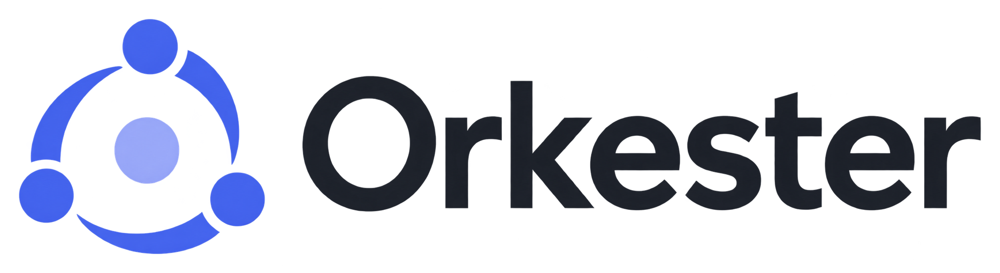
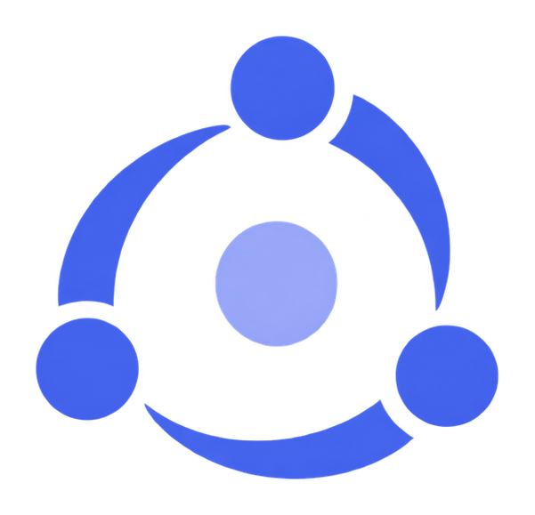

**Run a team of coding agents on an infinite canvas — and draw who talks to whom.**


English · [Português](README.pt-BR.md)

Claude Code, Codex and PowerShell run for real inside the cards, next to sticky notes, files and sketches.
The line you draw between two cards is the permission for one agent to talk to the other.

---

## Why this exists

A coding agent handles one task at a time, and handles it well. When the work grows, everyone reaches for the
same answer: open more terminals. At that point the bottleneck stops being the agent and becomes you — half a
dozen identical windows, none of them aware of the others, and the only way for one agent to build on another's
work is for you to copy and paste between them.

Orkester replaces the stack of windows with a canvas. Every terminal becomes a card with a name, a place and a
role; you draw a line between two cards, and from there the agents talk to each other on their own. The
arrangement that used to live only in your head becomes something you can see, save and reuse on the next
project.

Three ideas hold the rest together:

- **The canvas is the state.** Position, name, group and link are not decoration — they are how the app decides
  who can reach whom. Dragging a card inside a group *is* adding it to the team.
- **The link is the permission.** An agent only talks to the agents it is wired to. No loose agent broadcasting
  to the whole board.
- **The agent has hands.** Inside any terminal on the canvas there is the **`ork`** command: with it an agent
  opens new sessions, delegates, reads the screen of whoever it is linked to, rearranges the canvas and
  assembles its own team. Outside the app, the command refuses to run.

## Features

| | |
|---|---|
| **Real terminals** | Claude Code, Codex or PowerShell inside a card, with scrollback, zoom and copy. They survive workspace switches and resume the conversation when the app reopens. |
| **Delegation** | An agent opens another one already carrying context (`--funcao`, `--pedido`, `--arquivo`), waits for the answer, reads the screen, replies to menus and closes what it opened. |
| **Roles** | Name + prompt + folder. An agent is born knowing its part instead of being born empty. |
| **Bands** | Groups drawn as a frame: whoever sits inside talks to everyone else inside. |
| **Scores** | Whole teams saved — agents, roles, briefings, links, bands — raised at once in a new workspace, on any project. |
| **Routines** | A request typed into a card every X minutes, daily or weekly. If the terminal is busy, waiting on a question or finished, the routine **skips its turn** instead of typing in the middle of the work. |
| **Several windows** | Each workspace opens in its own window, and the app reopens the ones you had open, where you had them. |
| **Floors** | Isolated copies of the repository through `git worktree`, so two teams can work on the same project without stepping on each other. |
| **Code trees** | The files an agent touches become cards beside it, with the git diff, grouped by line of work. |
| **Context reading** | How much of its window each agent has spent, so you know when to clear it or hand the work over. |
| **The rest of the canvas** | Workspaces, sticky notes stored as `.md`, text, attachments, an embedded browser, freehand drawing, undo for everything, light and dark themes. |

## Install

Requires **Node 24** and **Windows 11 x64**.

```powershell
git clone https://github.com/luisgcazeredo/orkester.git
cd orkester/app
npm install
npm run instalar   # builds the installer and installs the app on this machine
```

The app opens from the **Orkester** shortcut (desktop and Start menu). Data lives in
`%USERPROFILE%\.orkester` — the canvas as JSON and sticky notes as `.md`, readable outside the app — and
survives uninstalling.

For development:

```powershell
npm run dev        # app with hot reload
npm run provas     # unit tests for the pure modules
npm run autoteste  # drives the real app with mouse and keyboard, checks everything, exits (0 = passed)
```

## The `ork` command

Runs inside a terminal on the canvas. The link between two cards is the permission; cards are addressed by
name.

```text
# where am I
ork quem                          you, who you are linked to, and the last known context
ork orcamento                     how much of its window the agent has spent
ork espacos | janela              list workspaces · open one in a window (--novo creates it)

# working with other agents
ork abrir claude|codex|shell      a new session beside you, already linked
                                  (--funcao, --pedido, --arquivo, --esperar)
ork pedir <name> "…"              send a request and wait for it to finish (returns the screen)
ork esperar | ver <name>          wait for it to finish · read the screen without sending anything
ork teclas <name> enter|esc|…     answer menus and prompts
ork limpar | fechar <name>        clear the context · close a session you opened
ork passar <name> | ork sair      hand over the sessions you opened · close your own card

# building the team
ork funcoes                       the saved roles, for use with `ork abrir --funcao`
ork banda | banda criar "Name"    groups: whoever is inside the frame talks to everyone inside
ork trocar <card> <agent>         swap the agent on a card you opened (the card stays, the agent changes)
ork partitura                     saved teams: `usar "Name"` raises one beside you, `salvar "Name"` stores it
 
# working the canvas
ork quadro                        every card with number, name, place and size, and the links
ork mover | arrumar               place cards (--x/--y, --dx/--dy) · lay them out in a grid (--colunas)
ork nome | ligar | desligar       rename a card · draw or remove the link between two agents
ork anotar "…" | juntar           write a note on the canvas · group cards (--soltar undoes it)
ork arvore nova|usar|mostrar      the card's code trees, one per line of work
```

Everything an agent does to the canvas **goes into the user's undo stack**, never deletes anything, never
touches a locked card or a code card, and only reaches the floor currently on screen.

The app writes the full manual as an `orkester` skill into `~/.claude/skills` and `~/.codex/skills`, so the
agent learns the command by itself the first time it needs it.

## Three ideas worth explaining

**Band.** A group drawn as a frame. There is no membership list — the frame is what says who belongs, so
dragging a card in or out *is* joining and leaving. A link attached to the band applies to every agent inside
it.

**Score.** A saved team. The folder is deliberately *not* saved: every card opens in the folder of the
workspace where the score was raised, so the same team works on any project. Each part's prompt comes from
today's role definition, never from a stale copy stored alongside it.

**Routine.** What only the app can do is know the state of the terminal before typing. A routine that writes in
the middle of an answer ruins the work, so it checks first and skips its turn.

## Under the hood

Electron · React · TypeScript · xterm.js · node-pty.

The canvas logic lives in pure modules (`app/src/shared/`), covered by tests that run in plain Node without
opening the app. On top of those, the autoteste launches the real app, builds a canvas, drives it with mouse and
keyboard and checks the result on screen. Today: **117 unit tests** and **147 UI checks** across 13 scenarios.

```text
app/src/shared/    pure canvas rules (bands, scores, agent swap, routines, files)
app/src/main/      main process: terminals, `ork` verbs, data on disk, autoteste
app/src/renderer/  the canvas, in React
app/src/cli/       the `ork` command the agent calls
identidade/        the brand and the scripts that generate the icon
```

## Status

Version **0.31.0**, in daily use on Windows. Canvas, terminals, delegation, roles, bands, scores, routines,
floors and code trees are done. The road to 1.0 continues through operations — what happens when an agent
hangs, runs out of credit, or the machine reboots — and a visual identity of its own.

## Brand



Three pieces orbiting a core: three agents around the same work. The versions with and without the wordmark,
the colors and the commands that regenerate the icon live in [`identidade/`](identidade/README.md).

---

A personal project by [@luisgcazeredo](https://github.com/luisgcazeredo), built for his own use. The code is
open to read and to borrow from; there is no promise of support or of compatibility between versions.
